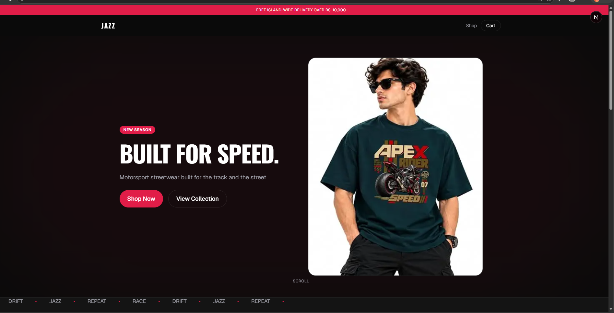
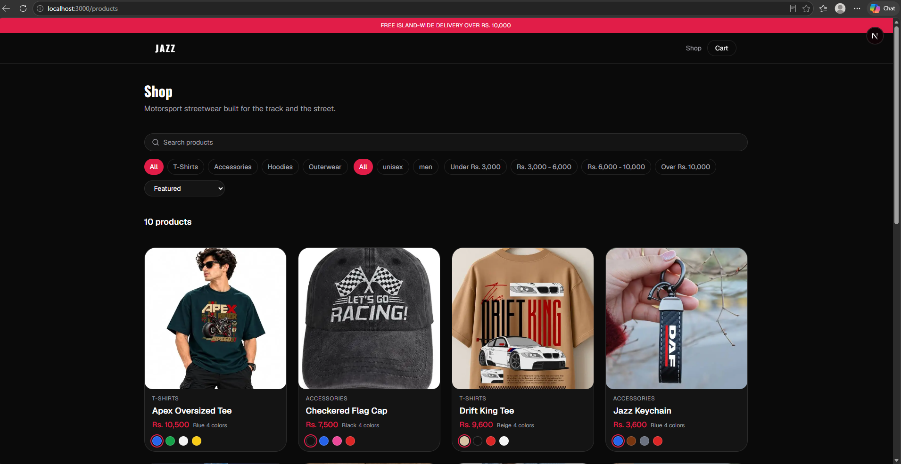
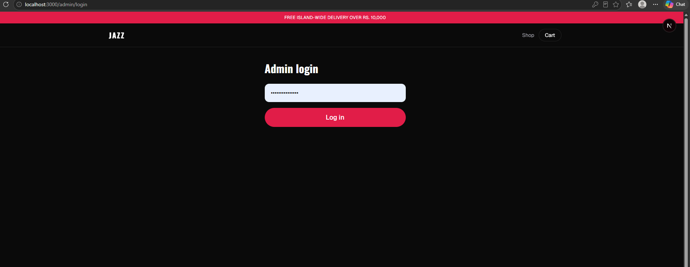
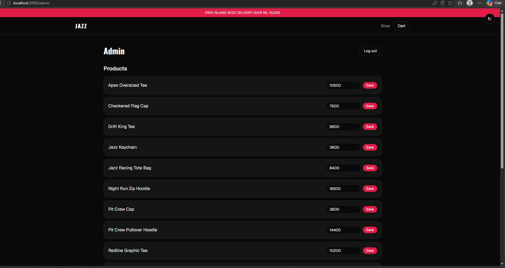
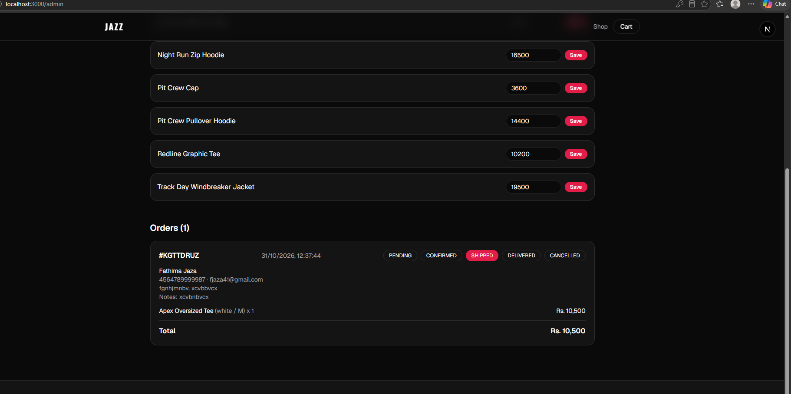

# Jazz Store

A full-stack e-commerce web app for premium motorsport-inspired apparel. Built as a portfolio project with a dark, luxury design, a Postgres database, server-side checkout and a password-protected admin area.
## Screenshots











## Features

**Storefront**
- Product search, sorting, price presets, and combined category and gender filters
- Mobile filter drawer
- Product detail pages with colour variants, sizes and quantity
- Cart drawer with persistent cart (browser storage)
- Prices shown in LKR (for example `Rs. 3,500`)

**Checkout and orders**
- Cash on Delivery checkout form
- Orders and order items saved to PostgreSQL
- Server-side validation: prices, colours, sizes and quantities are checked against the database, so prices sent from the browser are never trusted
- Order snapshots keep the product name and unit price at the time of purchase

**Admin** (`/admin`)
- Password-protected login (signed httpOnly cookie, constant-time password check)
- Orders list with customer details and items
- Order status updates (Pending, Confirmed, Shipped, Delivered, Cancelled)
- Edit product prices; storefront updates immediately

## Tech stack

- Next.js 16 (App Router, Server Components and Server Actions)
- TypeScript
- Tailwind CSS v4
- Prisma ORM 7 with the `@prisma/adapter-pg` driver adapter
- Supabase PostgreSQL

## Getting started

### 1. Install

```bash
npm install
```

### 2. Environment variables

Copy `.env.example` to `.env` and fill in your own values:

```
DATABASE_URL=
ADMIN_PASSWORD=
```

- `DATABASE_URL`: PostgreSQL connection string (Supabase Session Pooler works well)
- `ADMIN_PASSWORD`: password for `/admin` (use a long, unique value)

Never commit `.env`. It is git-ignored.

### 3. Set up the database

```bash
npx prisma migrate dev
npx prisma generate
npx tsx prisma/seed.ts
```

The seed script loads the sample products from `data/products.ts`. Re-running it does not overwrite prices already edited in the admin.

### 4. Run

```bash
npm run dev
```

Open http://localhost:3000. The admin is at http://localhost:3000/admin.

## Project structure

```
app/            Routes: home, shop, product detail, checkout, admin
components/     UI components (product grid, cart, hero, etc.)
data/           Seed data and shared types
lib/            Prisma client, product queries, admin auth
prisma/         Schema, migrations, seed script
```

## Known limitations and roadmap

- No online payment yet (Cash on Delivery only)
- No customer accounts; admin uses a single shared password
- Product add/delete and image upload from the admin are not built yet
- The local Prisma client and seed script relax TLS certificate verification for the Supabase pooler. This should be replaced with proper certificate trust before a production deployment
- Not deployed yet